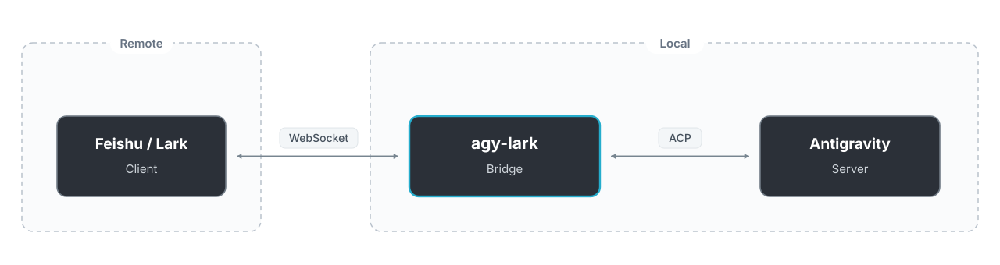

<div align="center">

<picture>
  <source media="(prefers-color-scheme: dark)" srcset="https://raw.githubusercontent.com/starswei/agy-lark/main/docs/assets/Logo-dark.svg" />
  <source media="(prefers-color-scheme: light)" srcset="https://raw.githubusercontent.com/starswei/agy-lark/main/docs/assets/Logo.svg" />
  
</picture>

# agy-lark

**Chat with local Antigravity directly from Feishu / Lark.**

**在飞书里直接驱动本地 Antigravity，轻量直连。**

A lightweight, native-ACP Feishu / Lark bridge powered by the official Python `lark-oapi` SDK —
delivering live streaming cards, mid-turn steering, timely cancellation via `session/cancel`, and interactive `/model` & `/effort` selection.

[](https://github.com/starswei/agy-lark/actions/workflows/ci.yml)
[](https://github.com/starswei/agy-lark/blob/main/LICENSE)
[](https://github.com/starswei/agy-lark/releases)

[English](https://github.com/starswei/agy-lark/blob/main/README.md) | [中文](https://github.com/starswei/agy-lark/blob/main/README.zh-CN.md)

</div>

---

> [!NOTE]
> **Project Status (`v0.1.1`)**: End-to-end Feishu / Lark ↔ local `agy acp --stdio` bridging is complete and verified across the offline unit/integration test suite and live Feishu sessions — featuring Fail-Closed `open_id` authorization, a single-process `lark-oapi` WebSocket daemon, persistent cross-restart ACP session recovery (`session/resume`), CardKit 2.0 streaming cards, mid-turn steering, `/stop` cancellation, and single-column `/model` & `/effort` interactive selector cards.

## What You Get

| Scenario | What `agy-lark` Does | What You Get |
| :--- | :--- | :--- |
| **Remote Coding via Chat** | Maps Feishu / Lark DM, thread, or `@bot` messages to persistent `agy` ACP sessions | Drive your local project workspace right from mobile or desktop chat |
| **Mid-Turn Steering** | Delivers follow-up instructions via `session/prompt` while a turn is actively running | Redirect or refine long tasks on the fly without waiting or restarting |
| **Timely Cancellation** | Card stop actions or `/stop` issue native ACP `session/cancel` for the active turn | Halts the current task cleanly while keeping full conversation context intact |
| **Live Streaming Cards** | Sends and updates CardKit 2.0 interactive cards in-process via `lark-oapi` with throttling | Real-time progress and Markdown replies in one clean card |
| **Model & Effort Control** | Supports `AGY_MODEL` / `AGY_EFFORT` defaults plus decoupled `/model` & `/effort` single-column cards | Switch models or multi-level thinking intensity interactively per conversation |
| **Lightweight Setup** | Runs in a single Python process over WebSocket and auto-discovers `agy` from `PATH` | Requires only Python 3.11+, `lark-oapi`, and basic app configuration to start |

## Architecture

`agy-lark` runs as a single Python process sitting cleanly between two protocol boundaries:

<p align="center">
  <picture>
    <source media="(prefers-color-scheme: dark)" srcset="https://raw.githubusercontent.com/starswei/agy-lark/main/docs/assets/architecture-dark.svg" />
    <source media="(prefers-color-scheme: light)" srcset="https://raw.githubusercontent.com/starswei/agy-lark/main/docs/assets/architecture-light.svg" />
    
  </picture>
</p>

- **Unified In-Process Feishu Transport (`lark-oapi`)**: Handles both message events (`im.message.receive_v1`) and card button callbacks (`card.action.trigger`) over a single WebSocket connection, while creating and streaming CardKit 2.0 updates over HTTPS.
- **Direct Native ACP (`agy acp --stdio`)**: Drives local sessions over bidirectional stdio JSON-RPC, enabling **mid-turn steering**, protocol-level **`session/cancel`**, and decoupled **`model` / `effort`** configuration.

<!--
## Preview

Uncomment after adding real Feishu / Lark card captures under `docs/assets/`:

<table>
<tr>
<td><br/><sub>Live CardKit 2.0 streaming reply with stop control</sub></td>
<td><br/><sub>Sending follow-up guidance mid-turn without losing context</sub></td>
</tr>
</table>
-->

## Quick Start

### Prerequisites

1. **Python 3.11+** (developed & verified with `3.13.9`)
2. **Antigravity CLI (`agy`)** installed locally and authenticated, with `agy` available on `PATH` (or configured via `AGY_EXE`)
3. **A Feishu / Lark Custom App** with Bot capability enabled:
   - Event subscription delivery mode: **Persistent Connection (WebSocket)**
   - Subscribe to `im.message.receive_v1` and card callback `card.action.trigger`
   - Required IM / CardKit bot permissions granted and app published

### Installation & Configuration

**Option 1: Install from GitHub Releases or PyPI (after `agylark` is published to PyPI)**

```bash
# Isolated CLI installation (recommended by PyPA once published to PyPI):
pipx install agylark
# or with uv:
uv tool install agylark
# or directly from a downloaded GitHub Release wheel inside a venv:
pip install ./agylark-<version>-py3-none-any.whl
```

**Option 2: Install from Source**

```bash
git clone https://github.com/starswei/agy-lark.git
cd agy-lark

python -m venv .venv
# Windows PowerShell: .venv\Scripts\Activate.ps1
# macOS / Linux:      source .venv/bin/activate

pip install -e .
cp .env.example .env
# Fill in FEISHU_APP_ID, FEISHU_APP_SECRET, and AGY_LARK_ALLOWED_OPEN_IDS
```

- **Optional presets**: Set `AGY_MODEL` and `AGY_EFFORT` in `.env` to auto-apply a preferred default model and thinking intensity on new ACP sessions, or leave them blank to use Antigravity's defaults.
- **Portable `.env` paths**: Relative paths configured inside `.env` (`AGY_DEFAULT_WORKSPACE`, `AGY_EXE`, `AGY_LARK_DATA_DIR`) resolve relative to the `.env` file's directory; externally set OS environment variables still resolve against the process current working directory (`CWD`).

> [!TIP]
> **`AGY_LARK_ALLOWED_OPEN_IDS` is your access allowlist**: list the Feishu / Lark user `open_id` values (`ou_...`, comma-separated) permitted to drive your local `agy`. Since the bridge grants chat access to your local workspace, leaving it empty rejects all requests by default for safety.

### Starting the Daemon

```bash
agylark --env-file .env -v
```

- Also available via the compatible `agy-lark` CLI alias (`pip install -e .` installs both `agylark` and `agy-lark`).

- `--env-file`: Path to your `.env` file (defaults to `.env` in the current directory; pass `""` to skip loading a `.env` file and read process environment variables only).
- `--verbose` / `-v`: Enables `DEBUG`-level logging (overrides `AGY_LARK_LOG_LEVEL`).

### Chat Commands

Send standalone slash commands in an authorized DM, group thread, or `@bot` mention (when enabled); text containing extra arguments passes through as a normal prompt:

- **`/stop`**: Issues ACP `session/cancel` for the active turn in the current conversation (equivalent to clicking the card's Stop button).
- **`/model`**: Sends a single-column CardKit 2.0 selector card listing available models; selecting a model updates only the session's model without overwriting thinking effort.
- **`/effort`**: Sends a single-column CardKit 2.0 selector card listing supported thinking intensity levels for the active model (including multi-level configurations such as 4 levels).

### Running Tests

Run the offline unit and daemon integration suite directly from the repository root:

```bash
python -W error -m unittest discover -s tests -v
```

To also include the optional real `agy acp` cross-restart E2E test (requires a locally installed and authenticated `agy` CLI), set `AGY_LARK_REAL_AGY_E2E=1`.

## Runtime & Safety Design

`agy-lark` is designed around explicit, fail-closed operational boundaries:

- **Fail-Closed Authorization**: If `AGY_LARK_ALLOWED_OPEN_IDS` is empty, **all** incoming messages and card actions (`stop`, `model`, `effort`) are rejected by default. Group `@mention` routing is disabled unless `AGY_LARK_ALLOW_GROUP_MENTION=true` is explicitly set.
- **Cross-Platform `agy` Discovery**: Resolves `AGY_EXE` first if set, otherwise looks up `agy` via `PATH` — no hardcoded OS-specific installation paths.
- **Throttled Streaming & Turn Safety**: Coalesces high-frequency ACP output chunks via `AGY_LARK_STREAM_THROTTLE` (default `0.25s`), enforces per-turn timeouts (`AGY_TURN_TIMEOUT_SECONDS`), and cleans up child pipes via ACP cancellation on `SIGINT` / `SIGTERM`.
- **Persistent Session & Config Recovery**: Atomically persists isolated conversation mappings (`p2p:<chat_id>`, thread aliases, and reply message bindings), workspace `cwd`, and selected model/effort in `{AGY_LARK_DATA_DIR}/sessions.json`. After a daemon or ACP subprocess restart, the first incoming turn or command resumes the prior session on demand via `session/resume` and replays its saved model and effort — safely falling back to a new session (or default settings) with an explicit diagnostic notice if the workspace changed, the session expired, or a saved option is unavailable.

## Privacy Notice

`agy-lark` strictly separates **public repository assets** from **private local runtime state**:

- **Tracked in Git**: source code (`src/agylark/`), unit tests (`tests/`), `.env.example`, `pyproject.toml`, `LICENSE`, documentation, and logo assets.
- **Local-only (`.gitignore`)**: `.env`, `FEISHU_APP_SECRET`, authorized `open_id` lists, `.agy-lark/`, `sessions.json`, logs, state/database files, and `.venv/`.

**Never commit `.env` or runtime state files to a public repository.**

## License

[MIT](https://github.com/starswei/agy-lark/blob/main/LICENSE)
