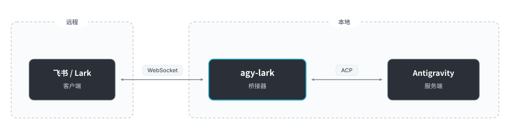

<div align="center">

<picture>
  <source media="(prefers-color-scheme: dark)" srcset="https://raw.githubusercontent.com/starswei/agy-lark/main/docs/assets/Logo-dark.svg" />
  <source media="(prefers-color-scheme: light)" srcset="https://raw.githubusercontent.com/starswei/agy-lark/main/docs/assets/Logo.svg" />
  
</picture>

# agy-lark

**Chat with local Antigravity directly from Feishu / Lark.**

**在飞书里直接驱动本地 Antigravity，轻量直连。**

基于官方 `lark-oapi` Python SDK 与原生 `agy acp --stdio` 协议构建的开源桥接工具——专注 CardKit 2.0 流式交互卡片、运行中插话纠偏、协议级及时停止，以及 `/model`、`/effort` 单列交互切换。

[](https://github.com/starswei/agy-lark/actions/workflows/ci.yml)
[](https://github.com/starswei/agy-lark/blob/main/LICENSE)
[](https://github.com/starswei/agy-lark/releases)

[English](https://github.com/starswei/agy-lark/blob/main/README.md) | [中文](https://github.com/starswei/agy-lark/blob/main/README.zh-CN.md)

</div>

---

> [!NOTE]
> **当前状态**（`v0.1.0`）：已完成基于 `lark-oapi` 单进程 WebSocket 守护服务、CardKit 2.0 实时流式交互卡片与本地 `agy acp --stdio` 协议内核的端到端闭环，并已完成全量单元测试与飞书客户端实测验证，支持默认拒绝鉴权、跨重启会话持久化与按需 `session/resume` 恢复、运行中插话、`/stop` 与停止按钮及时取消，以及 `/model`、`/effort` 单列交互切换。

## 你能得到什么

| 场景 | 系统做什么 | 你得到 |
| :--- | :--- | :--- |
| **飞书远程驱动** | 将私聊、话题串或群内 `@机器人` 消息映射并持久化到本地 `agy` 会话 | 出门在外也能用手机飞书直接让本地代码助手持续推进同一上下文 |
| **运行中插话纠偏** | 任务仍在执行时发送新消息，直接通过 ACP 的 `session/prompt` 注入引导 | 发现跑偏或临时补充条件时不必干等或重开，当场把方向拉回正轨 |
| **及时取消当前任务** | 点击卡片停止按钮或发 `/stop` 时，下发 ACP `session/cancel` 通知本轮停止 | 有序停下当前任务，同时完整保留已有会话上下文，可随时继续追问 |
| **实时流式交互卡片** | 通过官方 `lark-oapi` 持续节流更新飞书 CardKit 2.0 交互卡片 | 执行进度与最终 Markdown 回答实时呈现在一张卡片内，结构清晰 |
| **模型与思考强度控制** | 支持 `AGY_MODEL` / `AGY_EFFORT` 环境变量预设，并提供解耦的 `/model` 与 `/effort` 单列交互卡片 | 随时按会话切换模型或多档思考强度，互不覆写且在 ACP 重启后自动恢复 |
| **极简开源运行环境** | 单 Python 进程直连飞书长连接（WebSocket），并自动探测本机 `agy` | 仅需 Python 3.11+、`lark-oapi` 与基础配置即可启动 |

## 架构设计

`agy-lark` 作为轻量单进程守护服务，在两端之间只保留两道清晰边界：

<p align="center">
  <picture>
    <source media="(prefers-color-scheme: dark)" srcset="https://raw.githubusercontent.com/starswei/agy-lark/main/docs/assets/architecture-dark.zh-CN.svg" />
    <source media="(prefers-color-scheme: light)" srcset="https://raw.githubusercontent.com/starswei/agy-lark/main/docs/assets/architecture-light.zh-CN.svg" />
    
  </picture>
</p>

- **单进程飞书接入**（`lark-oapi`）：通过同一条 WebSocket 长连接统一接收消息事件（`im.message.receive_v1`）与卡片交互回调（`card.action.trigger`），并在进程内通过 HTTPS 直接完成 CardKit 2.0 卡片创建与节流刷新。
- **直连原生 ACP**（`agy acp --stdio`）：通过标准输入输出双向 JSON-RPC 协议流驱动本地会话，天然支持**运行中插话**（Steering）、协议级**及时取消**（`session/cancel`）以及彼此解耦的模型与思考强度配置。

<!--
## 界面预览

待后续补充实时截图到 `docs/assets/` 后取消注释启用：

<table>
<tr>
<td><br/><sub>CardKit 2.0 实时流式卡片与停止按钮</sub></td>
<td><br/><sub>任务进行中随时插话纠偏，不丢失上下文</sub></td>
</tr>
</table>
-->

## 快速开始

### 前置条件

1. **Python 3.11+**（当前基于 `3.13.9` 开发验证）
2. **本地可用的 Antigravity 命令行工具**（`agy`）：已完成登录并加入系统 `PATH`（或通过 `AGY_EXE` 显式指定路径）
3. **一个飞书 / Lark 企业自建应用**：
   - 已开启机器人能力
   - 事件与回调订阅方式选择**使用长连接接收事件**（WebSocket）
   - 订阅消息接收事件 `im.message.receive_v1` 与卡片交互回调 `card.action.trigger`
   - 开通消息与交互卡片所需权限并发布版本

### 本地安装与配置

**方式一：通过 PyPI 或 GitHub Release 安装（PyPI 首版上线后即可直接安装 `agylark`）**

```bash
# 推荐用于命令行工具的隔离安装方式（PyPI 上线后可用）：
pipx install agylark
# 或使用 uv：
uv tool install agylark
# 或在新建 venv 中安装从 GitHub Release 下载的 .whl 包：
pip install ./agylark-<version>-py3-none-any.whl
```

**方式二：从源码安装**

```bash
git clone https://github.com/starswei/agy-lark.git
cd agy-lark

python -m venv .venv
# Windows PowerShell: .venv\Scripts\Activate.ps1
# macOS / Linux:      source .venv/bin/activate

pip install -e .
cp .env.example .env
# 在 .env 中填入 FEISHU_APP_ID、FEISHU_APP_SECRET 与 AGY_LARK_ALLOWED_OPEN_IDS
```

- **可选预设参数**：可在 `.env` 中设置 `AGY_MODEL` 与 `AGY_EFFORT`，在新建 ACP 会话时自动下发默认模型与思考强度；留空则沿用 Antigravity 默认设置。
- **便携路径解析**：写入 `.env` 文件内的相对路径（`AGY_DEFAULT_WORKSPACE`、`AGY_EXE`、`AGY_LARK_DATA_DIR`）统一相对于 `.env` 所在目录解析；从外部系统环境变量传入的路径则仍保持相对于当前工作目录（`CWD`）的语义。

> [!TIP]
> **`AGY_LARK_ALLOWED_OPEN_IDS` 是使用者权限白名单** ：填的是允许通过飞书操控你本地 `agy` 的个人账号 `open_id`（`ou_` 开头，多个用英文逗号隔开）。因为本桥接能驱动本地代码助手读写工程与执行命令，留空时将默认拒绝所有访问以确保安全。

### 启动守护服务

```bash
agylark --env-file .env -v
```

- 同时保留兼容命令别名 `agy-lark`（安装后 `agylark` 与 `agy-lark` 均可直接调用）。

- `--env-file`：指定环境变量配置文件路径（默认读取当前工作目录下的 `.env`；传空字符串 `""` 可跳过 `.env` 读取，仅使用进程环境变量）。
- `--verbose` / `-v`：开启 `DEBUG` 级别详细日志输出（优先级高于 `AGY_LARK_LOG_LEVEL`）。

### 对话斜杠命令

在已授权的私聊、群聊话题串或开启 `@机器人` 的群聊中发送独立命令即可生效（大小写不敏感，带附加参数的消息将作为普通对话提示词透传给后端）：

- **`/stop`**：向当前会话正在运行的回合发送 ACP `session/cancel` 取消请求（与点击卡片上的停止按钮等效）。
- **`/model`**：返回单列全宽（`fill`）CardKit 2.0 模型选择卡片，仅切换当前会话的模型，不覆盖思考强度设置。
- **`/effort`**：返回单列全宽 CardKit 2.0 思考强度选择卡片，支持当前模型的多档思考强度（如 4 档），仅调整思考强度而不影响当前模型选择。

### 运行单元测试

在仓库根目录直接运行离线单元测试与守护集成测试：

```bash
python -W error -m unittest discover -s tests -v
```

若需同时运行真实 `agy acp` 跨重启端到端回归测试（需本机已安装并登录 `agy` CLI），可设置环境变量 `AGY_LARK_REAL_AGY_E2E=1`。

## 运行时与安全设计

- **默认拒绝权限策略**（Fail-Closed）：若 `AGY_LARK_ALLOWED_OPEN_IDS` 留空，守护进程默认**拦截所有传入消息与卡片动作**（含停止、切模型、切思考强度），防止把本机代码权限意外暴露给外部用户；群聊 `@机器人` 亦默认关闭，需设置 `AGY_LARK_ALLOW_GROUP_MENTION=true` 才开启。
- **跨平台程序发现**：优先读取环境变量 `AGY_EXE`，未配置时通过系统 `PATH` 自动定位，不写死任何个人盘符路径。
- **节流更新与优雅退场**：通过 `AGY_LARK_STREAM_THROTTLE`（默认 `0.25s`）合并高频流式输出，支持单回合安全超时（`AGY_TURN_TIMEOUT_SECONDS`），并在收到 `SIGINT` / `SIGTERM` 时执行清理与有序退出。
- **跨重启会话持久化与按需恢复**：将私聊、群话题别名及回复消息引用链、当前 `session_id`、工作区 `cwd` 以及所选模型和思考强度原子化持久化到 `{AGY_LARK_DATA_DIR}/sessions.json`。守护进程或本地 ACP 子进程重启后，对应会话在收到首轮消息、`/model`、`/effort` 或卡片交互时通过 `session/resume` 按需恢复原上下文并重放模型与思考强度；若工作区路径变更、原会话失效或旧配置不可用，则安全降级新建会话（或回退默认设置）并附上诊断提示。

## 隐私边界

`agy-lark` 严格隔离**开源仓库资产**与**本地私人运行数据**：

- **提交到 Git 仓库**：源码（`src/agylark/`）、单元测试（`tests/`）、`.env.example`、`pyproject.toml`、`LICENSE`、文档与 Logo 资源。
- **仅保留在本地**（已写入 `.gitignore`）：`.env`、`FEISHU_APP_SECRET`、授权用户的 `open_id` 列表、`.agy-lark/`、`sessions.json`、日志、本地状态／数据库文件以及 `.venv/`。

**严禁将 `.env` 或运行时状态文件提交到公开仓库**。

## License

[MIT](https://github.com/starswei/agy-lark/blob/main/LICENSE)
